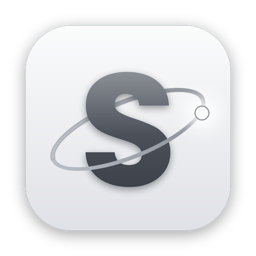

<p align="center">
  
</p>

<h1 align="center">MacOS Spice Client</h1>

<p align="center">
  A native macOS client for SPICE virtual machine consoles: Proxmox VE, QEMU/libvirt and oVirt.
</p>

---

MacOS Spice Client opens the virt-viewer connection files (`.vv`) that Proxmox and other
virtualization platforms hand out and shows the virtual machine in a fast, native Mac
window. The SPICE protocol is implemented from scratch in Swift, the screen is drawn with
Metal, and the app runs fully sandboxed.

## Features

**Connecting**
- Opens `.vv` files directly — double-click the file your browser downloads after clicking
  **SPICE** in Proxmox, or drop it on the app.
- **Virtual Machines** window (⌘0): browse the VMs of your Proxmox servers and connect,
  start, shut down, reboot, pause or stop them, without downloading a file.
- **Power menu** in every Proxmox session window.
- **Automatic reconnect** after network drops or sleep, in the same window — shared
  devices, the mounted disc image and the microphone come back on their own.

**Display**
- Metal rendering with Retina support; the guest resolution follows the window size.
- Hardware video decoding (H.264 and H.265 via VideoToolbox) when the server streams video.
- All SPICE image formats: QUIC, LZ, GLZ, LZ4, JPEG and MJPEG.
- Multiple monitors (up to four), each in its own window, with full-screen support.

**Input**
- Full keyboard support with the ⌘ key sent as the Windows key (⌘Q, ⌘Tab and friends stay
  with macOS), Caps Lock sync and Ctrl+Alt+Del.
- Seamless pointer with the guest agent, or a captured pointer for guests without one.
- Hotkeys from the connection file (full screen, release cursor, secure attention).

**Sharing with the virtual machine**
- **Clipboard**: copy and paste text and images in both directions (opt-in in Settings).
- **Files**: drag files onto the VM's screen to copy them into it.
- **Sound**: guest audio plays on the Mac with low latency; the microphone can be switched
  on per session (it is always off until you allow it).
- **USB devices**: redirect devices plugged into the Mac to the VM.
- **Disc images**: insert an `.iso` into the VM as a USB CD/DVD drive.
- **Smartcards and security keys**: share a smartcard or a YubiKey's PIV function with the
  VM — it appears there as a standard USB smartcard reader.

**Security**
- TLS with the connection file's CA as the only trust anchor and host-subject checking;
  secure channels are never downgraded, and unencrypted connections need your confirmation.
- One-time tickets stay in memory only and are wiped after use.
- Proxmox API tokens are stored in the Keychain.
- App Sandbox and Hardened Runtime; clipboard, USB, smartcard and microphone sharing only on request.

## Installation

Requires **macOS 26 Tahoe** or later, on Apple silicon or Intel.

### Homebrew

```bash
brew tap pawelwiecaszek/macos-spice-client https://github.com/pawelwiecaszek/macos-spice-client
brew install --cask macos-spice-client
```

Update with `brew upgrade --cask macos-spice-client`.

### Download

Download the latest `.dmg` from [Releases](https://github.com/pawelwiecaszek/macos-spice-client/releases),
open it and drag **MacOS Spice Client** to Applications.

The app is ad-hoc signed and not notarized by Apple. Each release lists the DMG's SHA-256
checksum (`.sha256` file) so you can verify the download.

The first time you open a downloaded copy, macOS blocks
it: verify the checksum, then open **System Settings › Privacy & Security** and click
**Open Anyway**. The Homebrew cask verifies the checksum but leaves Gatekeeper's quarantine
in place, so the same one-time approval applies.

### Build from source

Needs Xcode 26 or later (with the Metal Toolchain component).

```bash
git clone https://github.com/pawelwiecaszek/macos-spice-client.git
cd macos-spice-client
xcodebuild -project SpiceClient.xcodeproj -scheme SpiceClient -configuration Release \
  -derivedDataPath build build
open "build/Build/Products/Release/MacOS Spice Client.app"
```

The protocol library builds and tests on its own: `cd Packages/SpiceKit && swift test`.

## Using it with Proxmox VE

1. Set the VM's **Display** to **SPICE** (Hardware › Display).
2. Click **Console › SPICE** in the Proxmox web interface and open the downloaded file —
   the ticket inside is valid for a few seconds and only once.

Recommended in the VM:
- **spice-vdagent** (Linux) or the **SPICE guest tools** (Windows) for the clipboard, file
  transfer, a seamless pointer and automatic resolution.
- **USB redirection**: add one *Spice Port* USB device per device you want to share
  (Hardware › Add › USB Device). A free port is also needed for a disc image or smartcard.
- **Sound**: add an audio device with the *SPICE* driver (Hardware › Add › Audio Device).
- **Hardware video decoding**: enable *Video Streaming* (Options › Spice Enhancements).

### Proxmox API access (optional)

For the Virtual Machines window, the Power menu and reconnecting with a fresh ticket, add
your server under **Settings › Proxmox** with an API token (Datacenter › Permissions ›
API Tokens). The token needs **VM.Audit**, **VM.PowerMgmt** and **VM.Console** — for
example the *PVEVMUser* role on `/vms`. If privilege separation is on, give the role to
the token itself, not only to its user.

## License

[MIT](LICENSE). SPICE protocol constants come from the BSD-licensed
[spice-protocol](https://gitlab.freedesktop.org/spice/spice-protocol) headers.
